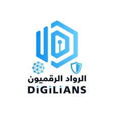
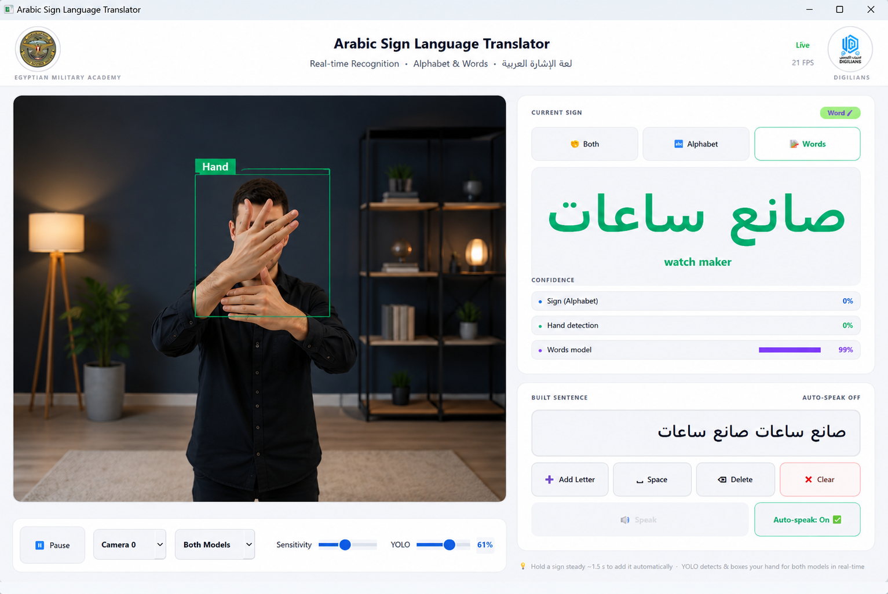

<div align="center">


&nbsp;&nbsp;&nbsp;&nbsp;


<br/>

# Arabic Sign Language Translator

### Real-time Recognition · Alphabet & Words · لغة الإشارة العربية

[](https://python.org)
[](https://doc.qt.io/qtforpython/)
[](https://tensorflow.org)
[](https://onnxruntime.ai)
[](LICENSE)

A production-ready desktop application for **real-time Arabic Sign Language recognition**, built with PySide6/Qt and powered by a dual deep learning architecture. Translates hand gestures into Arabic text and speech — instantly.

</div>

---

## 📸 Demo

<div align="center">
  
</div>

> *Real-time detection of "صانع ساعات" (watch maker) with 99% confidence using the Words model.*

---

## ⬇️ Download & Run (No Installation Required)

> **Just click the button below — the app will download as a ready-to-run `.zip` file. No Python, no setup needed.**

<div align="center">

[](https://github.com/mshawki417/ARSL-APP/releases/download/v.1/dist.zip)

</div>

### ▶️ How to Run

1. Click the download button above — `dist.zip` will download automatically
2. **Extract** the zip file anywhere on your PC
3. Open the extracted `dist/` folder
4. Double-click **`main.exe`** to launch the app
5. Allow camera access if prompted — and you're ready to go 🎉

> ✅ **No Python installation required** — everything is bundled inside the `.exe`
>
> ⚠️ **Windows only** — if Windows Defender shows a warning, click *"More info" → "Run anyway"* (this is normal for unsigned executables)

---

## ✨ Key Features

| Feature | Description |
|---|---|
| 🖐️ **Real-time Hand Detection** | YOLO-powered bounding box detection at 20+ FPS |
| 🔤 **Alphabet Recognition** | 31-class Arabic alphabet via EfficientNetB0 |
| 🗣️ **Word Recognition** | 32 ArSL words via ONNX model + MediaPipe hand landmarks |
| 🏆 **Dual-Model Fusion** | Both models run simultaneously; highest confidence wins |
| ✍️ **Sentence Builder** | Add signs one by one to compose full sentences |
| 🔊 **Arabic TTS** | Auto-speak recognized signs using gTTS |
| ⚙️ **Adjustable Controls** | Tune Sensitivity, YOLO threshold, camera source, and model mode live |
| 🎨 **Modern UI** | Clean white interface with institutional branding |

---

## 🧠 Model Architecture

```
Input Frame (Webcam)
       │
       ▼
 YOLO Hand Detector ──► Bounding Box
       │
       ├──────────────────────────────┐
       ▼                              ▼
EfficientNetB0               MediaPipe Landmarks
(Alphabet Model)              + Scaler + ONNX
  31 classes                    32 classes
       │                              │
       └──────────┬───────────────────┘
                  ▼
         Best Confidence Wins
                  │
                  ▼
          Arabic Text Output
                  │
                  ▼
            gTTS Speech
```

| Model | Task | Classes | Format | Size |
|---|---|---|---|---|
| EfficientNetB0 | Arabic Alphabet | 31 | `.keras` | ~61 MB |
| MediaPipe + ONNX | ArSL Words | 32 | `.onnx` | ~1.2 MB |
| Scaler | Landmark normalization | — | `.pkl` | 4 KB |

> 📦 **Note:** `.keras` and `.h5` files are stored via **Git LFS** due to their size.

---

## 🗂️ Project Structure

```
arabic-sign-language-translator/
│
├── main.py                  # Application entry point
├── main_window.py           # Main UI window (PySide6)
├── camera_worker.py         # Camera capture thread
├── hand_detector.py         # YOLO-based hand detection
├── inference.py             # Alphabet model inference (EfficientNetB0)
├── inference_words.py       # Word model inference (ONNX + MediaPipe)
├── labels.py                # Alphabet class labels (31 classes)
├── labels_words.py          # Word class labels (32 classes)
├── tts_worker.py            # Arabic TTS worker thread
│
├── best_model.keras         # EfficientNetB0 weights      [Git LFS]
├── best_sign_model.h5       # Backup model weights        [Git LFS]
├── sign_model.onnx          # ONNX word recognition model
├── scaler.pkl               # Landmark feature scaler
│
├── logo_military.png        # Egyptian Military Academy logo
├── logo_digilians.png       # DiGiLiANS logo
├── requirements.txt         # Python dependencies
├── main.spec                # PyInstaller build spec
└── README.md
```

---

## ⚙️ Installation

### Prerequisites

- Python **3.9+**
- A connected **webcam**
- Git LFS (for model files)

### Clone & Setup

```bash
# 1. Clone the repository
git clone https://github.com/YOUR_USERNAME/arabic-sign-language-translator.git
cd arabic-sign-language-translator

# 2. Pull large model files (requires Git LFS)
git lfs pull

# 3. Create a virtual environment (recommended)
python -m venv venv
source venv/bin/activate      # Linux / macOS
venv\Scripts\activate         # Windows

# 4. Install dependencies
pip install -r requirements.txt
```

### Key Dependencies

| Package | Purpose |
|---|---|
| `PySide6` | GUI framework (Qt6) |
| `opencv-python` | Camera capture & frame processing |
| `mediapipe` | Hand landmark extraction |
| `onnxruntime` | ONNX model inference |
| `tensorflow` / `keras` | EfficientNetB0 alphabet model |
| `ultralytics` | YOLO hand detection |
| `gtts` + `pygame` | Arabic text-to-speech |

---

## 🚀 Running the Application

```bash
python main.py
```

### UI Controls

| Control | Description |
|---|---|
| **Both / Alphabet / Words** | Switch active recognition model |
| **Sensitivity** | Confidence threshold for sign acceptance |
| **YOLO** | Hand detection threshold |
| **Camera** | Select camera source |
| **Add Letter** | Append current sign to sentence |
| **Auto-speak** | Toggle automatic TTS on sign detection |

---

## 📦 Build as Executable

A `main.spec` file is included for PyInstaller packaging:

```bash
pip install pyinstaller
pyinstaller main.spec
```

Output executable will be in the `dist/` folder.

---

## 🏛️ Acknowledgements

This project was developed under the supervision of the **Egyptian Military Academy** in collaboration with **DiGiLiANS**.

Special thanks to the creators of the **KArSL-502** dataset used for word-level model training.

---

## 👤 Author

**Mustafa** — AI & Deep Learning Engineer

[](https://linkedin.com)
[](https://github.com)

---

<div align="center">

*Built with ❤️ for Arabic accessibility — Cairo, Egypt 🇪🇬*

</div>
